# Logging System

Merlin produces logs from several sources: the job scheduler and its runs,
HTTP requests, the WebSocket terminal, the attention watcher, and the tunnel
lifecycle. This document explains the logging concepts, how data flows
through the system, and how rotation keeps disk usage bounded.

## Architecture

Three distinct concepts, each with its own storage:

```
~/.merlin/
├── logs/
│   ├── merlin.log              # App log (unified, rotating)
│   ├── events.jsonl        # Lifecycle events (JSONL)
│   └── activity/               # Sanitized Timeline metadata, daily JSONL (flag on)
├── job-logs/                   # Job run logs, one file per run
└── job-runs/                   # A run's private directory while its window lives
```

- **`logs/`** — observability. Everything here can be rotated or deleted without breaking the app.
- **`job-logs/`** — job-specific execution records with the run's output.
- **`job-runs/`** — the live state of a run (its prompt, pid, outcome); removed with its window by retention, after the run is recorded.

Startup removes what older releases left: `logs/raw-sessions/`, `logs/claude/`, `logs/cron_runner.log` and `sessions/`, and moves `logs/engine-log.jsonl` here as `events.jsonl`, without its `bot_event` lines.

## Who Writes Where


([mermaid source](logging-system/producers.mmd))

### Triggers

| Trigger | What happens | Modules involved |
|---|---|---|
| **Job** | Scheduler tick or webhook fire → a run in its window → supervised to its record → run log written | `job/__init__.py`, `job/runner.py`, `job/runs.py`, `job/supervisor.py`, `job/logs.py` |
| **Webhook** | The front desk checks the secret and fires, or rejects | `webhooks/`, `job/webhook.py` |
| **HTTP request** | FastAPI handles request → file browse, auth, API, static files | `main.py`, `files/`, `commits/`, `auth.py` |
| **WebSocket** | Terminal session → PTY bridge → tmux | `terminal/routes.py` |
| **Attention** | A window finished or asks → an event, routed to the page and the push sender | `notifications/routes.py` (the routing record), `notifications/push.py` (delivery failures) |
| **Tunnel lifecycle** | SaaS tunnel (Merlin Cloud) → connect, reconnect, fail | `saas_tunnel.py` |
| **App lifecycle** | Startup and shutdown | `main.py` |

### Unified logger hierarchy

All Python loggers use the `merlin.*` tree. The root `merlin` logger has a `RotatingFileHandler` writing to `merlin.log`. All children inherit it automatically.

```
merlin                      → merlin.log (RotatingFileHandler, 10 MB × 5)
├── merlin.terminal         (WebSocket connect/disconnect, PTY errors)
├── merlin.saas_tunnel      (SaaS portal tunnel)
├── merlin.ssh              (SSH server events)
├── merlin.job             (job dispatch, runs, supervision, retention)
├── merlin.notifications    (the watcher, push delivery)
├── merlin.workspace        (snapshot and restore)
├── merlin.notes            (notes git operations, when the extension is on)
├── merlin.structured_log   (log cleanup events)
└── merlin.ext.*            (extensions — see docs/dev/extension-system.md)
    ├── merlin.ext.video_scenes
    ├── merlin.ext.video_scenes.renderer
    └── ...
```

The `RotatingFileHandler` is configured in `main.py _setup_logging()`, called at server startup. File handler level is **INFO** — DEBUG stays on console only.

Extensions get a logger injected automatically at load time (`merlin.ext.<ext_id>`), or can create sub-loggers via `from merlin_ext import get_logger`. See [extension-system.md](extension-system.md#logging) for details.

The job runner (`job/runner.py`) runs as a separate subprocess. When running standalone (`__main__`), it configures its own `FileHandler` to the same `merlin.log` at INFO level. When imported from the main process or tests, it inherits the parent's handler.

### Log format

**merlin.log** (text):
```
2026-11-02 10:30:45 INFO     [merlin.job] Dispatcher started at 2026-11-02T09:30:45+00:00
2026-11-02 10:30:46 INFO     [merlin.job] [7f861aa7] Job digest started in merlin-jobs:3
2026-11-02 10:31:12 INFO     [merlin.job] [7f861aa7] Job digest finished (exit=0, 26.1s)
```

**events.jsonl** (JSONL):
```json
{"type": "job_dispatch", "timestamp": "2026-11-02T10:30:46+00:00", "job_id": "digest", "event": "started", "trigger": "webhook", "request_id": "7f861aa7-...", "duration": 0, "exit_code": 0}
{"type": "webhook_request", "timestamp": "2026-11-02T10:30:50+00:00", "source": "job", "target": "digest", "ip": "203.0.113.4", "outcome": "launched", "run_id": "7f861aa7-...", "request_id": "a1b2c3d4-..."}
```

## A job run's data flow

A run writes to three places, in this order:

1. **Its window** (`merlin-jobs` tmux session): the agent's or the command's output, as the user sees it. `run.sh` publishes the exit code into the run directory and stamps the window's `@job_exit`.
2. **The run directory** (`job-runs/<run>/`): `meta.json`, the prompt, the pid file, `outcome.json` once the supervisor decided the finish.
3. **The record**: `.history.json`, then the run log `job-logs/{job_id}/{timestamp}.json` (the pane's output captured at the finish), then `result.json` in the run directory, which marks the run recorded (two-phase, so a crash between the writes is resumed, never duplicated).

## What Each File Contains

| File | Format | Contains output? | Contains metadata? | Rotation |
|---|---|---|---|---|
| `logs/events.jsonl` | JSONL | **No** | Yes (type, timestamp, outcome, ids) | 180-day retention |
| `logs/merlin.log` | Text | No | No (free-text lifecycle events) | 10 MB × 5 backups |
| `logs/activity/*.jsonl` | JSONL | No (metadata only) | Yes (lifecycle, provider, window) | 90 days |
| `job-logs/{job}/*.json` | JSON | Yes (the pane's output, bounded) | Yes (exit_code, duration, run_id, agent, trigger) | 50 per job |
| `job-runs/<run>/` | files | The prompt, the pid, the outcome | Yes | With the window |

### Timeline activity is a separate log

`logs/activity/YYYY-MM-DD.jsonl` belongs to the built-in Timeline extension
(behind `MERLIN_FEATURES=timeline`). It contains sanitized interactive-agent
and automation lifecycle metadata, not agent output. Provider hooks and
`merlin timeline emit` write it directly while the dashboard is stopped; a
job run's window is an ordinary interactive agent to them.

Activity capture has separate consent, private files, an 8 KiB record bound, and
a 64 MiB daily bound. Its write path enforces 90-day retention once per UTC day,
uses a durable event-id index for idempotency, and reports bounded current-day
capture drops from caps, lock timeouts, normalization, or I/O without persisting
exception text. It rejects content-bearing
fields such as prompts, commands, inputs, outputs, responses, and secrets. Its
complete contract is
[`agent-activity-timeline.md`](agent-activity-timeline.md).

### What `events.jsonl` contains

| Event type | When | Key fields |
|---|---|---|
| `job_dispatch` / `started` | A run is about to start (`job/runner.py`) | job_id, trigger, request_id (the run id) |
| `job_dispatch` / `completed` | A run finished with exit 0 | job_id, duration, exit_code, trigger, request_id |
| `job_dispatch` / `failed` | A run finished with a non-zero exit (a deadline is 124, a closed window 130) | job_id, duration, exit_code, trigger, request_id |
| `job_runner_crash` | The job runner subprocess died | exit_code, stderr |
| `webhook_request` | Inbound webhook handled by the front desk (every outcome: `launched`, `coalesced`, `rejected_secret`, `throttled`, ...) | source, target, ip, outcome, run_id, request_id |
| `attention_routed` | A notification event routed (`notifications/routes.py`): to the page, and to the push sender when devices are subscribed | seq, target, window, state, pushed, skipped, looking |
| `push_failed`, `push_removed` | A push delivery failed, or a dead subscription was dropped (`notifications/push.py`) | the endpoint's host, the status |
| `app_started` | Merlin server started | host, port, cwd, extensions |
| `app_stopped` | Merlin server stopped | — |

The `request_id` of a `job_dispatch` line is the run id: it correlates the
three lifecycle records of one run with its `webhook_request` line, its run
log and its window. Each typed event has a model in `lib/event_log.py`
(`JobDispatchEvent`, `JobRunnerCrashEvent`, `WebhookRequestEvent`,
`AppLifecycleEvent`); lines of a type an older release wrote (`invocation`,
`bot_event`) have none and still read: the reader returns them as
`BaseEvent` with every field kept.

## Who Reads What


([mermaid source](logging-system/consumers.mmd))

1. **Jobs dashboard** (`/jobs`) → reads `events.jsonl` via `lib/event_log.py` for the **crash banner** (`job_runner_crash` events) and the **Webhooks tab** (`webhook_request` events). Reads `job-logs/` for the run history and each run's log.
2. **Timeline page** (`/timeline`, flag on) → reads `logs/activity/`.
3. **`merlin.log`** → manual debugging only (SSH into server and read).

> **Consumer-side schema.** Writers stay free-form (`log_event(**fields)`), but every reader goes through typed Pydantic models in `lib/event_log.py` (`JobDispatchEvent`, `JobRunnerCrashEvent`, `WebhookRequestEvent`, `AppLifecycleEvent`). Each model sets `extra="allow"`, so adding a field on the writer side never breaks a reader; lines that fail JSON decoding or model validation are skipped and counted (a single `WARNING` summary), never raised; unknown types come back as `BaseEvent`.

## Rotation

All log types have bounded growth:

| Log | Strategy | Retention | Max disk |
|---|---|---|---|
| `logs/merlin.log` | `RotatingFileHandler` | 10 MB × 5 backups | 50 MB |
| `logs/events.jsonl` | Age-based cleanup at startup | 180 days | Varies |
| `logs/activity/` | Daily partitions; once-daily cleanup on append | 90 days | 64 MB/day |
| `job-logs/` | Count-based per job | 50 per job | Varies |
| `job-runs/` | Removed with the run's window, once recorded | An hour to a day | Varies |

Cleanup runs at server startup via `structured_log.cleanup_old_logs()`, called from `main.py start_server()`. The retention constant is `EVENT_LOG_RETENTION_DAYS = 180` in `lib/structured_log.py`; the window retention rules are in `job/retention.py`.

## What is NOT logged

These parts of the app produce no structured events (though app-level errors go to `merlin.log`):

- **File browser** (`files/`) — no logging of file operations
- **Commits browser** (`commits/`) — no logging of git history views
- **Auth successes/failures** — only auto-password warning logged
- **Settings page** — configuration changes not logged
- **HTTP errors** (401, 404, 500) — no structured events, only uvicorn access log
- **The agent's conversation** — Merlin keeps no transcript of its own; the agent's own files are the agent's

## Files

| File | Purpose |
|---|---|
| `lib/structured_log.py` | `log_event()`, `cleanup_old_logs()` — event log writer + rotation |
| `lib/event_log.py` | Canonical **reader** for `events.jsonl` — typed Pydantic event models, malformed-line resilience. Used by the jobs page (crash banner, webhook requests). |
| `timeline/schema.py`, `timeline/writer.py`, `timeline/store.py` | Timeline's independent typed record, locked writer, bounded reader, and retention. |
| `main.py` | `_setup_logging()` — configures `merlin.*` RotatingFileHandler, calls cleanup at startup |
| `job/runner.py` | Job dispatcher — writes `job_dispatch` started/completed/failed to the event log, and the record of a run (`.history.json`, the run log, `result.json`) |
| `job/runs.py`, `job/supervisor.py`, `job/retention.py` | The run directory, the finish, the removal with the window |
| `job/__init__.py` | Job scheduler — writes to event log on crash (job_runner_crash) |
| `job/logs.py` | Job run log CRUD — reads/writes `job-logs/`, has `cleanup_logs()` |
| `job/routes.py` | Jobs dashboard API — reads `events.jsonl` via `lib/event_log.py` (crash banner, webhook events), `job-logs/` for history |
| `webhooks/` | The front desk — writes `webhook_request` for every outcome |
| `notifications/routes.py` | Writes `attention_routed` for every routed notification event |
| `notifications/push.py` | Writes `push_failed` and `push_removed` on delivery failures |
| `terminal/routes.py` | Terminal WebSocket — logs connect/disconnect, PTY errors |
| `saas_tunnel.py` | SaaS tunnel — logs connect/disconnect, port forwarding, auth |
| `ssh_server.py` | SSH server — logs host key, sessions, PTY operations |
| `notes/git_ops.py` | Notes — logs git operation failures |
