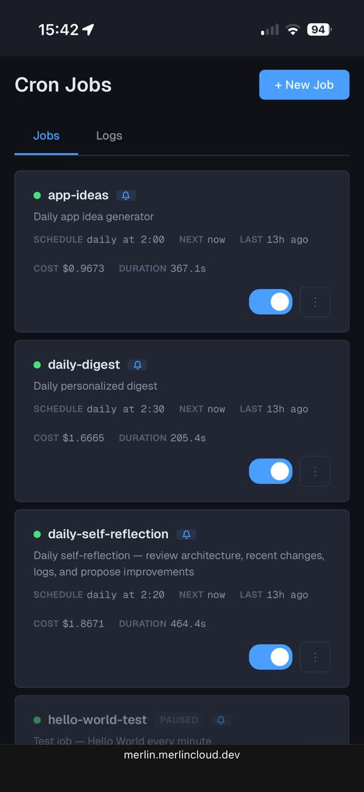
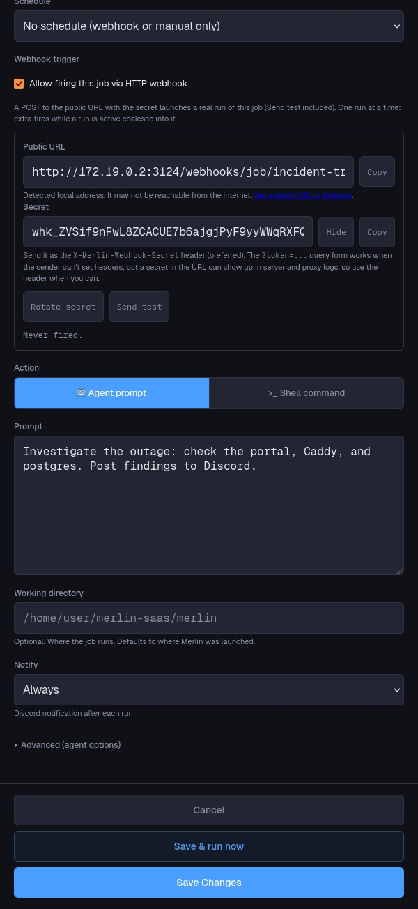
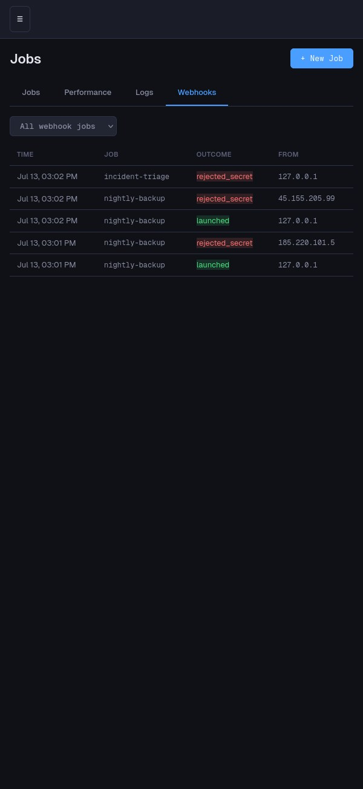

# Jobs

A **job** is one unit of work (an agent run or a shell command) that
Merlin can launch three ways: on a **schedule**, by an **incoming webhook**,
or **by hand**. The triggers are independent: a job can have a schedule, a
webhook, both, or neither (manual-only). No system crontab is involved; the
`/jobs` page runs its own scheduler that starts with the dashboard.

**Every run opens a tmux window.** A job run, agent or script, lives in a
window of the `merlin-jobs` session, like a window you would open yourself
in the Terminal. An agent job runs the agent's real interface there (Claude
Code or Codex), so you can watch it work, step in, answer it, or talk to it
by voice. This is the pillar that works while you sleep: a job is woken by
the clock or by the world, and Merlin [notifies you](notifications.md) when
it is done or needs you.



The page has tabs for **Jobs** and **Logs**, plus a **Webhooks** tab once
any job has a webhook. Everything here can also be driven from the terminal
with `merlin job`.

## See your jobs

The Jobs tab shows one card per job: a status dot (gray: never run, green:
last run succeeded, red: last run failed, exit code in the tooltip), the job
ID, an `agent` or `command` badge, a `webhook` badge when it is
webhook-firable, and a `paused` tag when disabled. Below that: the schedule
in plain words (or `none`), timezone, next and last run, the last run's
duration, and an **open** link to the last run's window while it exists.

## Create a job

Hit **+ New Job**. Job IDs are slugs: lowercase letters, digits, single
hyphens, starting with a letter, max 30 characters (the field auto-cleans
what you type). The description is free text.

## Triggers

A job needs at least one way to run. Set any combination of the two triggers
below; a job with neither is **manual-only** (see the end of this section).

### Schedule

Pick a **Schedule** in the editor. You never have to write a cron
expression: choose Every N minutes, Hourly, Daily, Weekly (day chips with
Weekdays / Weekends / Every day shortcuts), Monthly, Custom for a raw
expression, or **No schedule** for a webhook- or manual-only job. A live
preview shows the human-readable schedule, the next 3 run times in your
timezone, and the generated cron expression.

Each job has its own timezone, defaulting to your browser's. Schedules are
DST-aware: a 17:00 job stays at 17:00 wall-clock across the time change. The
server-wide default comes from `JOB_TIMEZONE` (the old `CRON_TIMEZONE` name is
still accepted as a deprecated alias).

### Webhook



Any job can be launched by an external HTTP call: an uptime monitor's
incident alert, a CI pipeline, a shortcut on your phone. In the editor,
check **Allow firing this job via HTTP webhook** and save: Merlin generates
a secret and shows the job's public URL. A `POST` to that URL with the
secret launches the job exactly like the scheduler would:

```bash
curl -X POST -H 'X-Merlin-Webhook-Secret: whk_...' \
  https://your-instance/webhooks/job/my-job
```

If the sender cannot set headers, append `?token=whk_...` instead. Prefer
the header when you can: a secret in the URL can show up in server and
proxy logs, whereas a header does not. `merlin job url <id>` prints the URL, the secret,
and that exact curl command; `merlin job test <id>` fires the hook against
your own server as a dry run of the whole path.

What to know:

- **One run at a time.** A fire while a run is already active is accepted
  (HTTP 200) but coalesces into the running one: a monitor that fires five
  times during one incident launches exactly one agent.
- **Fresh session per fire.** Each webhook-launched agent run starts with a
  clean session, so two separate incidents never share context.
- **The secret is the key.** Anyone with the URL + secret can run the job
  (and a command job runs a shell command), so treat it like a credential.
  Rotate it anytime from the editor or `merlin job webhook <id> --rotate`;
  the old secret stops working immediately. The secret is a 256-bit token,
  so guessing it is hopeless. There is no in-app rate limiter; flood
  protection, if you need it, is a job for your reverse proxy (on Merlin
  Cloud it is handled for you).
- **Where the URL comes from.** On Merlin Cloud it rides your instance's own
  subdomain (`https://{you}.merlincloud.dev/webhooks/job/{id}`), discovered
  automatically and following along if you rename your environment.
  Self-hosted behind your own tunnel or proxy, set the **Public URL** in
  Settings (or `MERLIN_DASHBOARD_URL` in `~/.merlin/config.env`) and the
  editor and CLI print it.

### Manual only

A job with **no schedule and no webhook** runs only when you fire it: from
the card's **Run Now**, **Save & run now**, or `merlin job trigger <id>`.
Handy for a task you want on tap without it running on its own.

## Choose the action

The **Agent prompt / Shell command** toggle decides what runs:

- **Agent prompt**: the agent's real interactive run, in a window. Write the
  prompt as if you were typing it into the agent. Pick the **Agent**: Claude
  Code (the default) or Codex.
- **Shell command**: runs in your Merlin environment via `bash -lc`, in a
  window too. No agent. stdout and stderr land in the window and in the run
  log.

**Working directory** is optional and applies to both types: the job's
setting, else where Merlin was launched, else `$HOME`. Point an agent job at
a project repo and it picks up that repo's `CLAUDE.md`, exactly like an agent
you would open there by hand. Clear the field to fall back to the default.

### Agent jobs run with every permission check bypassed

A job runs unattended by definition, so an agent job is launched with
`claude --dangerously-skip-permissions` or
`codex --dangerously-bypass-approvals-and-sandbox`: the agent edits files and
runs commands without asking. There is no gate, only this warning, repeated
in the editor and by `merlin job add`. **Give a job only work you would let
run unattended**, and point it at a working directory you are happy to let
it change.

### The state hooks must be installed

Merlin knows a run finished through the agent's own hooks, the ones that
drive the window pills (busy, done, needs an answer). They must be installed
in the agent's user config for the agent you pick: `merlin config
agent-state-hooks auto` installs them for both Claude Code and Codex. Without
them, or with the agent's binary missing from `PATH`, the editor warns you up
front and a run fails at once with that message in its log, opening no
window.

**Codex runs its hooks only in a directory it trusts.** In a directory Codex
does not know, a Codex job still does its work, but no hook fires: Merlin
cannot see the turn end, marks the run as needing an answer after two
minutes, and only the deadline closes it. Point a Codex job at a directory
Codex trusts (one under a trusted project in its `config.toml`, or trust it
once from a Codex session there), the way you would before working in it by
hand. Claude Code asks instead: a directory it has never seen gets its trust
dialog in the window (see the troubleshooting entry on a run marked "Needs
an answer").

## Set notifications

**Notify** is Always, Errors only, or Never: a report after each run. When
the Discord [bot](bot.md) is enabled you can override the destination channel
per job; leave it empty to use the bot's default channel.

## The run's window

Every run starts fresh: a new window, named after the job, in the
`merlin-jobs` tmux session, in the job's working directory. Nothing is
carried over from the previous run; anything worth keeping between runs must
land in files (the notes, the knowledge base, a report in the repo).

- **Watch it or step in.** Open the Terminal and switch to the `merlin-jobs`
  session (the Sessions panel lists its windows like any other agent
  window, with the same pills), or follow the **open** link on the card,
  in the Logs tab, or in the notification. An agent job is the real agent:
  answer its question, give it a follow-up, or talk to it by voice. A
  command job's window shows the command's output and then drops you in a
  shell in the job's directory.
- **The run ends, the window stays.** A run is finished when the agent
  finishes its turn (or when you take over and it goes idle), when a command
  exits, when a deadline passes (1 hour for a command, 6 hours for an agent:
  the job is ended, exit code 124), or when the window is closed (exit code
  130). The agent keeps running after the run finished: the window is yours
  now.
- **Windows are tidied up.** A run that succeeded, untouched since, closes
  after an hour or when the job runs again, whichever comes first. A run
  that failed, or a window you stepped into, stays a day after the last
  activity. A window someone is looking at is never closed. With the window
  goes its private run directory; the run log stays.
- **A stuck start is reported.** An agent that is still not working two
  minutes after its launch is waiting on something Merlin cannot see (a
  trust or bypass dialog on a fresh machine): the window is marked as
  needing an answer, so you get the ordinary "Needs an answer"
  notification, and you can answer it in the window. The deadline still
  applies.

## Save and run

**Create Job** saves it. **Save & run now** saves, fires an immediate run,
and drops you straight into that job's logs. A freshly created scheduled job
otherwise waits for its next occurrence (see troubleshooting).

## Run, pause, edit, delete

Each card has a toggle switch (off pauses the job: the scheduler skips it,
webhook fires are refused, and the card dims with a `paused` tag) and a
three-dot menu: **Edit** (reopens the form, the ID is locked), **Run Now**
(background run, works even on paused jobs), **View Logs** (Logs tab
pre-filtered to that job), and **Delete** (confirm dialog; removes the job
and all its logs, state, and locks).

## Read run history

The Logs tab lists runs newest-first across all jobs, with a per-job filter:
time, job, status, trigger (schedule / webhook / manual), duration, agent.
Click a row to expand the captured output: a command's output, or the
agent's whole pane at the end of the run. While a run's window still exists,
the row carries an **Open window** link to it.

## Watch webhook traffic



The **Webhooks** tab (shown once any job has a webhook) is the audit view
for the public endpoint. It lists every fire **and every rejected attempt**
(wrong secret, unknown job) with the caller's IP: a public endpoint's
failed hits are worth seeing. Outcomes are color-coded: `launched` and
`coalesced` in green/amber, rejections in red. Filter by webhook job with
the dropdown. The editor also shows a "last fired" line per job.

## Manage from the terminal

`merlin job` covers the same jobs: add, list, get, enable, disable, remove,
trigger, history, plus the webhook trigger (`webhook`, `url`, `test`).
`merlin job --help` has the full reference. Two examples:

```bash
# A scheduled agent job
merlin job add --schedule "0 7 * * *" \
  --prompt "Summarize yesterday's commits and write the highlights to REPORT.md" \
  --description "Morning digest"

# A webhook-only Codex job, then print its public URL + secret
merlin job add --prompt "Triage the outage" --agent codex \
  --description "Incident triage" --webhook
merlin job url incident-triage
```

The ID is auto-slugged from the description unless you pass one. Omit
`--schedule` for a webhook- or manual-only job (passing an empty
`--schedule ""` is an error, to catch an unset shell variable). `--agent`
picks Claude Code (the default) or Codex. The CLI creates agent prompt jobs;
command jobs, working directories, and per-job timezones are set in the web
UI. `merlin job add` prints the bypass warning on stderr, so its stdout stays
one JSON document. `merlin job trigger <id>` runs a job immediately,
bypassing the schedule, waits for the run and prints its exit code, run id
and window; `merlin job history` shows recent runs.

## Mobile notes

- The create/edit form goes fullscreen on a phone (centered dialog on
  desktop), and footer buttons stack with the primary action closest to your
  thumb.
- Time and date fields open the native iOS picker, restyled to match the
  rest of the form; inputs are sized to avoid the iOS focus zoom.
- Job cards stack info above actions, and buttons and form controls keep
  comfortable touch targets.

## Troubleshooting

- **A new job did not run right away**: the scheduler registers a job the
  first time it sees it and waits for the next scheduled occurrence. Use Save
  & run now, Run Now, or `merlin job trigger` to fire it now.
- **A run was skipped, not run late**: if Merlin was down past a job's grace
  window (15 minutes by default, per-job overridable), the missed run is
  skipped and the schedule advances.
- **A webhook returned 401 / 403 / 404**: `401` is a bad or missing secret,
  `403` is a disabled job, `404` is an unknown job or one with no webhook.
  Check the Webhooks tab for the logged attempt.
- **A webhook fire "coalesced"**: a run was already in flight, so the fire
  joined it instead of starting a second run. This is expected under
  repeated fires for one incident.
- **Red banner on /jobs**: the scheduler crashed in the last 24 hours. Check
  the logs, then dismiss.
- **"Job already running (locked)"**: a per-job lock prevents overlapping
  runs; the scheduler skips a job that is mid-run and `merlin job trigger`
  reports the lock. Wait for the current run to finish.
- **A run exited with code 124**: the deadline passed (1 hour for a command,
  6 hours for an agent) and Merlin ended the job; the run log says so. The
  window stays, so you can read what happened.
- **A run exited with code 130**: its window was closed before the run
  ended.
- **A run exited with code 127, or 1 with "state hooks are not installed"**:
  the agent's binary is not on `PATH`, or Merlin's hooks are not installed in
  that agent's config. Run `merlin config agent-state-hooks auto` and check
  the editor's warning.
- **An agent run is marked "Needs an answer" right after its launch**: the
  agent is stuck on a dialog Merlin cannot see (trust this folder, the bypass
  confirmation, a login). Open the window and answer it once; later runs on
  that machine start clean.
- **No notification**: "Errors only" skips successful runs by design, and
  "Never" skips all of them.
- **422 when saving an edit**: switching a job's type requires filling the
  matching field (a command job needs a command, a prompt job needs a
  prompt).
- **"A job with this ID already exists"**: job IDs are unique; pick another.
- **Wrong timezone behavior**: an invalid per-job timezone falls back to the
  server default. An invalid server-wide `JOB_TIMEZONE` shows up as
  recurring scheduler crashes (the red banner) while schedule previews fall
  back to UTC; fix the value in `config.env`.
- **Truncated output**: the log viewer caps run output at 100KB with an
  explicit marker. Merlin keeps the last 50 execution logs and a rolling
  100-run history per job.
