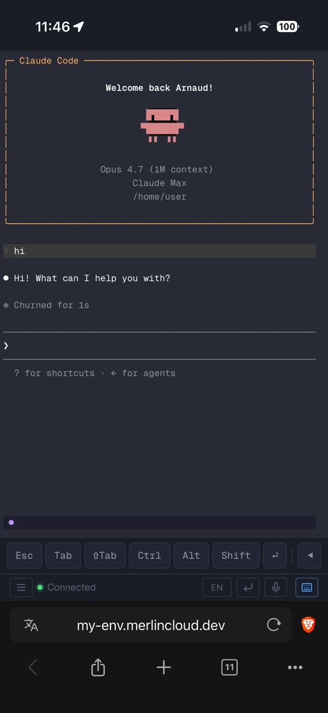
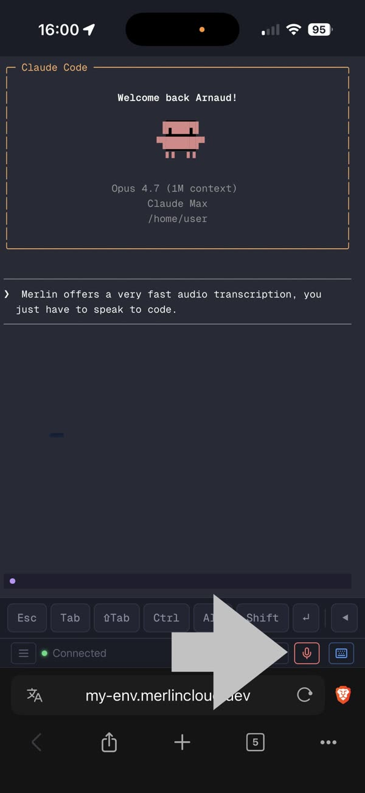

# Terminal

A full terminal in your browser at `/terminal` (same login as the rest of
the dashboard). It attaches to a persistent tmux session, so closing the
tab, losing signal, or reloading never kills your shell: reopen the page
and you are exactly where you left off. It is built for phone use: touch
gestures, a virtual key toolbar, full clipboard interop, and voice input
are all first-class.



The terminal is the heart of the coding environment: it is where you and
[your agent](agents.md) actually do the work, and what you learn here
lands in the [notes and knowledge base](notes.md) that every other
channel reads.

## Open a shell

Navigate to `/terminal`. The shell starts in the directory where `merlin`
was launched, the same directory the [file browser](files.md) and
[commits page](commits.md) operate on. A status dot in the bottom bar
shows Connecting / Connected / Disconnected; reconnection is automatic
with backoff (1s up to 30s).

## Resume after closing the tab

Nothing to do: tmux persistence handles it. On disconnect, Merlin kills
only the tmux client, never the session, and reattaches to the existing
session when you come back. Multiple browser tabs attach to the same
session, and SSH access shares it too: phone, desktop browser, and SSH
are one continuous workspace.

## Get your workspace back after a restart

tmux survives a closed tab, not a reboot or a power cut. Merlin covers that
case: it keeps a snapshot of your sessions, saved every 15 seconds when
something changed. After the machine restarts, the first page you open shows
a banner: *Your last workspace didn't come back*, with the sessions it would
bring back and when they were saved. **Restore** rebuilds them; **Dismiss**
drops the offer.

What comes back:

- every session and window, with the same names, window numbers, pane
  layouts and directories;
- every Claude Code and Codex conversation, resumed where it was, with the
  options it was launched with (model, effort, permission mode...).

What does not: scrollback and screen contents, environment variables set
only at launch (`FOO=1 claude`), and any other program. A pane that ran a dev
server, an editor or a script comes back as a shell in its directory, and
Merlin never reruns the command for you: rerunning an arbitrary command can
have side effects, so that stays your call. An agent cut mid-turn is
resumed like the others; tell it to continue.

A session whose name is already in use is left as it is. The one exception
is the session the terminal creates by itself when you open it before
clicking Restore: Merlin fills it with your saved windows.

The banner also appears after `tmux kill-server`, since Merlin cannot tell a
deliberate kill from a crash. Dismiss it. Restarting Merlin itself never
shows it, because your tmux sessions keep running.

## Manage windows

Each tmux window is a separate shell. F2 creates a window, F3/F4 switch
to the previous/next one, F5 kills the current one. On mobile the
toolbar shows them in the order `◀`, `+`, `▶`, `✕` (previous, new,
next, kill). The active window is shown by a background highlight in the
status bar.

The key toolbar is visible by default on touch devices and hidden on
desktop; the keyboard icon in the status bar toggles it.

## Sessions

Windows live inside a tmux **session**. You can have several sessions and
organise them however you like, one per project or one per group of
projects that go together. The **Sessions** button (far right of the
status bar) opens the switcher: a docked panel on desktop, a full-screen
sheet on mobile.

The switcher mirrors tmux exactly. It lists every session, and under each
one every window it holds, with the same `○` / `◐` / `?` / `●` activity dot a
window shows in the status bar. Tap a session to switch to it; tap a
window to jump straight to it. Switching only moves the tab you are on:
your phone and your laptop each stay where you left them.

- **New session** — the `+` button. Type a project directory and it opens
  a session there (or switches to it if one already exists for that
  directory).
- **Rename / close** — the pencil and `×` on a session or a window. Close
  asks for a second tap to confirm. You cannot close your last session.
- The Sessions button badge counts windows **waiting on you across all
  sessions**, so a background session that finishes still reaches you.

The bottom row of window tabs in the terminal is tmux's own status line,
so it always shows the windows of whichever session you are currently on.

## Agent-state pills

When you run [Claude Code or Codex](agents.md) in a window, its pill in the
tmux status bar encodes what that session is doing, so one glance at the
tab bar tells you which session is working, which is stuck on a question,
which just finished, and which you have already looked at:

- `○` idle (grey): nothing is running.
- `◐` working (amber): the agent is mid-turn.
- `?` asking (sky): the agent has stopped mid-turn and needs an answer.
- `●` done (green): the turn finished and it is waiting on you.

The green `●` is an *unread* marker. It clears when you switch to that
window, or when you switch away after watching it finish. A window that
finishes in the background stays green until you visit it, so nothing
that wants your attention is lost while you work elsewhere.

The sky `?` is different: it means a dialog is open and the agent cannot
continue without you. That happens when it asks you to choose between
several approaches, when it presents a plan for approval, or when it
needs permission to run something. Looking at the window does **not**
clear it, because the question is still unanswered. Answering does.

Pressing `Esc` in a window that is working or asking interrupts the agent's
turn and sets its pill back to the grey `○` at once. Claude Code reports
nothing when a turn is interrupted, so the pill takes that from the keypress
itself. If the agent was in fact still working, its next tool call or the
end of its turn corrects the pill.

Windows that are not running Claude Code or Codex (a plain shell, or another
agent) keep the classic `●` active / `○` inactive dots, so nothing changes for
them.

For history rather than current state, open the [Agent Activity
Timeline](dev/agent-activity-timeline.md). It uses separate, explicit consent and
records sanitized lifecycle metadata from supported agents. The state pills and
Timeline can be enabled or disabled independently. Timeline prefers the stable
identity installed with the pills for liveness; without it, Timeline follows
the provider's current tmux session/window as a weaker live signal and keeps its
own private actor key.

### Turn the pills on or off

The pills need small state hooks in your Claude Code and Codex configs
(`~/.claude/settings.json` and `$CODEX_HOME/hooks.json`, normally
`~/.codex/hooks.json`), so Merlin asks before installing them. The first time
there is something to install, a banner appears at the top of the dashboard
with four choices:

- **Always**: install it and keep it updated automatically.
- **Just once**: install it now, but ask again next time it changes.
- **Not now**: skip for now, ask again later.
- **Never**: remove Merlin's hook and stop asking.

You can change your mind any time from **Settings -> Agent-state pills**,
or from the CLI:

```bash
merlin config agent-state-hooks         # show the current choice
merlin config agent-state-hooks auto    # always install and keep updated
merlin config agent-state-hooks ask     # ask via the dashboard banner
merlin config agent-state-hooks off     # remove Merlin's hook, stop asking
```

Merlin only ever touches its own marked entries. Existing hooks and any other
settings in either file are left alone.

> **Codex requires hook review.** On the next Codex launch, open `/hooks` and
> trust Merlin's new or changed definitions. Codex deliberately skips
> unreviewed user hooks. This trust step is separate from Merlin's install
> consent.
>
> **Already-open sessions need a restart.** A `claude` or `codex` session that
> was already running when the hook was installed or updated will not show
> pills until you exit and relaunch the agent in that window. New sessions pick
> it up right away, once Codex's hook definitions are trusted.

Want to be told instead of looking? The bell in the bottom bar turns the same signal into
browser notifications, an app badge and push to your phone. See
[Notifications](notifications.md).

## Copy and paste

Desktop copy: select with the mouse; on release the selection lands in
the OS clipboard with a "Copied!" flash. Ctrl+Shift+C copies your
selection explicitly. Ctrl+C stays SIGINT, never copy.

Paste, five ways: Ctrl+V, Ctrl+Shift+V, right-click on the terminal, the
clipboard toolbar button, or the mobile Paste pill (see mobile notes).
A "Pasted!" flash confirms; pastes are capped at 1 MB.

On macOS, paste is Cmd+V: it pastes text and images natively, with no
browser clipboard prompt. Ctrl+V is deliberately not intercepted there;
it reaches the terminal as quoted-insert (`^V`), the way native Mac
terminals treat it.

Paste an image: with an image in the clipboard, any paste path uploads it
to `/tmp/merlin-clipboard/` and types the file path into the terminal,
ready to hand to your agent. Drag-and-drop a file does the same, and the
picture toolbar button opens a file picker. Max 100 MB; uploads are
cleaned up after an hour.

## Use the clipboard from the shell

`merlin-clip` bridges the shell and the browser clipboard:

```bash
echo "hello" | merlin-clip copy   # copy to browser clipboard
merlin-clip paste                  # output last pasted text
echo "hello" | merlin-clip         # shorthand (pipe = copy)
```

tmux mouse selection is already wired to it. To make NeoVim yanks (`yy`,
visual `y`) reach your phone or desktop clipboard, add to your config:

```lua
if vim.fn.executable('merlin-clip') == 1 then
    vim.g.clipboard = {
        name = 'merlin',
        copy = { ['+'] = {'merlin-clip', 'copy'}, ['*'] = {'merlin-clip', 'copy'} },
        paste = { ['+'] = {'merlin-clip', 'paste'}, ['*'] = {'merlin-clip', 'paste'} },
    }
end
vim.o.clipboard = 'unnamedplus'
```

Outside Merlin, NeoVim falls back to the OS clipboard as usual.

## Dictate instead of typing

Tap the mic button to record, tap again to stop, and the audio uploads and
the transcribed text appears in the terminal. The server injects the text
itself, so you can lock your phone right after the upload finishes.
Toggle the `↵` auto-enter button to submit transcriptions automatically,
hands-free. The EN/FR selector picks the language, and both choices persist
in the browser. Recordings are capped at 25 MB.

The text lands in the window you were on when you stopped the recording, even
if you switch window or switch device while the upload is still going. Dictate
from your phone into the window your phone is showing and it stays there, whatever
your desktop is doing. The one catch: if you close that window before the text
arrives, the text is lost rather than sent somewhere else.



Transcription needs a backend, picked in priority order:
[Merlin Cloud](getting-started.md#merlin-cloud) (`MERLIN_SAAS_TOKEN`,
nothing to configure), the OpenAI Whisper API
(`OPENAI_API_KEY`), or local faster-whisper (a one-time ~1.5GB model
download, works offline). `merlin setup` prompts for the OpenAI key, or append
`OPENAI_API_KEY=sk-...` to `~/.merlin/config.env`.

## Talk with the agent (voice mode)

Voice mode turns the window you are on into a hands-free conversation with the
Claude Code agent running in it, for the car (phone on a mount, screen on) or a
walk. Tap the **Voice** button in the status bar: a full-screen radio console
covers the terminal. Talk, pause, and after about a second and a half of silence
what you said is transcribed and sent to the agent. The agent answers in a style
written for the ear, Merlin reads the answer aloud, then listens again. Code and
long output stay in the terminal: the voice says so instead of reading them.

- **Tap anywhere** while you talk to send now; while the answer plays, to skip
  the rest of it; on an error, to try again.
- **Stop agent** sends Escape to the agent. **Exit** leaves voice mode, and the
  next prompt you type is back to normal.
- When the agent needs a permission, the console plays an alert, says so, and
  shows **Yes** (Enter) and **No** (Escape).
- The console shows no text of the conversation, neither what you said nor the
  answer: it reads as a voice call, not as something to read while driving. The
  terminal under it keeps everything.
- **EN / FR** picks the language you speak and the voice that answers. It
  follows the dictation language.
- The microphone is closed while the agent works and while the answer plays, so
  the agent never hears itself and the phone does not lower the voice's volume. Keep the screen on: the console holds
  a wake lock while it is open.
- If the phone loses the connection, voice mode keeps going on the server and
  the console catches up when it reconnects. After a reload, tap once to give
  it the audio and the microphone back.

Voice mode needs three things, and the button, dimmed, says which is missing:

1. **A text-to-speech server** that speaks the OpenAI `audio/speech` API. Point
   Merlin at its API root:

   ```bash
   merlin config tts-url http://127.0.0.1:8880/v1
   ```

   Merlin ships one for an NVIDIA GPU, Kokoro behind that API, in its
   repository (`tools/kokoro-tts-server.py`). It downloads its model on the
   first run (about 354 MB) and needs only uv and the NVIDIA driver:

   ```bash
   uv run --script tools/kokoro-tts-server.py --device cuda
   ```

   Run `--help` for the options (port, models directory, offline, API key).
   Optional keys in `~/.merlin/config.env`: `MERLIN_TTS_API_KEY`,
   `MERLIN_TTS_VOICE_EN` (default `af_heart`), `MERLIN_TTS_VOICE_FR` (default
   `ff_siwis`), `MERLIN_TTS_SPEED` (default `1.05`), `MERLIN_TTS_MODEL`,
   `MERLIN_TTS_FORMAT`.
2. **Transcription**, the same backend as dictation (above).
3. **Claude Code in the window, with Merlin's agent hooks** (the ones behind the
   [agent-state pills](#agent-state-pills)). Voice mode adds one hook that tells
   the agent it is being heard. After updating Merlin, restart Merlin, then
   restart the agent once so it picks up the new hook. Codex windows are not
   supported yet.

## Jump to commits

The branch toolbar button looks up the terminal's current directory and
opens the [commits page](commits.md) for that repo. It flashes "Not a git
repo" if you are not in one.

## Mobile notes

- Swipe vertically to scroll; tap to click and focus (which opens the
  on-screen keyboard); rotating the phone resizes the terminal.
- Drag horizontally to select text; on release a green **Copy** pill
  appears near your finger, tap it to copy. Hold a finger still for half
  a second for a blue **Paste** pill. The pills are not decoration:
  mobile browsers only allow clipboard access from a real tap.
- Modifiers are sticky: tap Ctrl, Alt, or Shift to arm it (the button
  highlights), then press a key; it applies once and clears. Esc, Tab,
  `⇧Tab`, and `↵` send immediately. Arrow keys repeat when held.
- Voice survives bad connectivity: recordings are saved locally before
  upload and the upload retries three times with backoff.

## Troubleshooting

- **Clipboard does nothing / "Clipboard blocked" flash**: the Clipboard
  API requires HTTPS, so use your tunnel URL, not plain http. On mobile,
  use the pills or the toolbar buttons. `/terminal/clipboard-test` is the built-in
  diagnostic page; its "trace" button runs the terminal's own paste logic and
  prints every step, so it shows exactly where a paste stopped.
- **The paste status tells you which problem you have**: "Clipboard blocked"
  means the browser refused the read (permission, or a paste prompt you
  dismissed). "Clipboard empty" means it let us look and there was nothing to
  paste. "Clipboard unavailable" means the browser exposes no clipboard API at
  all, which on a normal browser means the page is not on HTTPS.
- **Clipboard icon with `?` or red `✕` in the status bar**: the browser
  permission is unset or denied. Click the icon to trigger the prompt; if
  red, enable clipboard access in your browser settings. On Safari and
  Firefox the icon stays hidden (no persistent permission there); every
  paste just needs a tap.
- **Mic button with a yellow `!` badge**: no transcription backend is
  configured; set `OPENAI_API_KEY` or `MERLIN_SAAS_TOKEN`.
- **Voice over plain HTTP**: fails with "[Voice requires HTTPS — mic API unavailable over HTTP]"; and
  "[Microphone permission denied]" means the browser blocked mic access.
- **Voice upload failed (yellow pulsing mic)**: the recording is kept
  locally and survives a page reload; tap the mic to retry once you have
  signal.
- **"Copied — Ctrl+Shift+C for system"**: the automatic clipboard write
  was blocked; press Ctrl+Shift+C to copy the same text explicitly.
- **"Unauthorized — reload page"**: your session cookie expired; reload
  and log in again.
- **"Terminal unavailable"**: tmux is not installed on the host; the page
  shows the install command.
